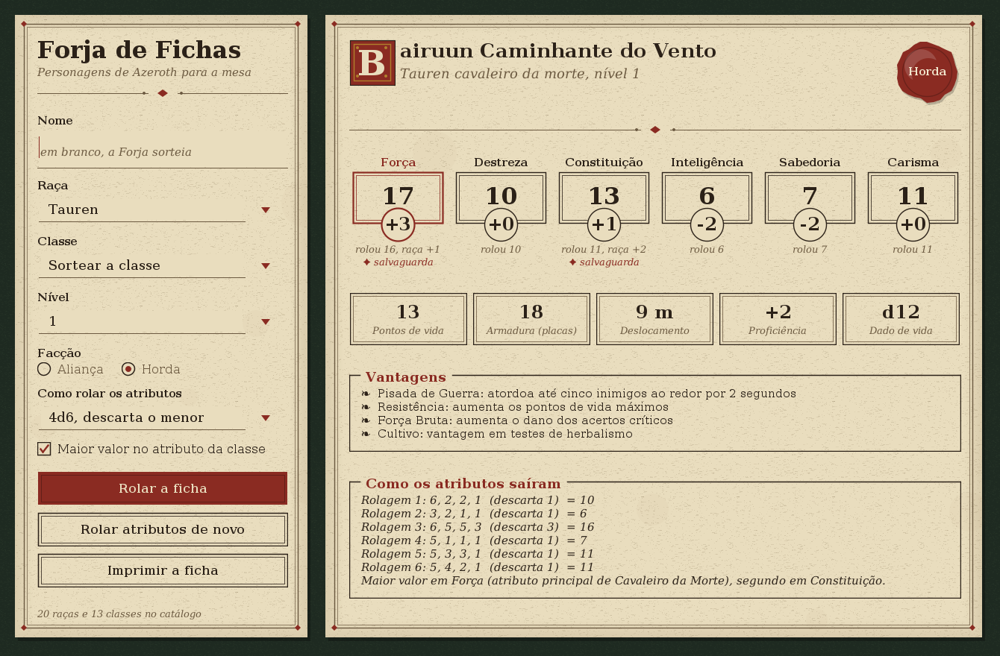
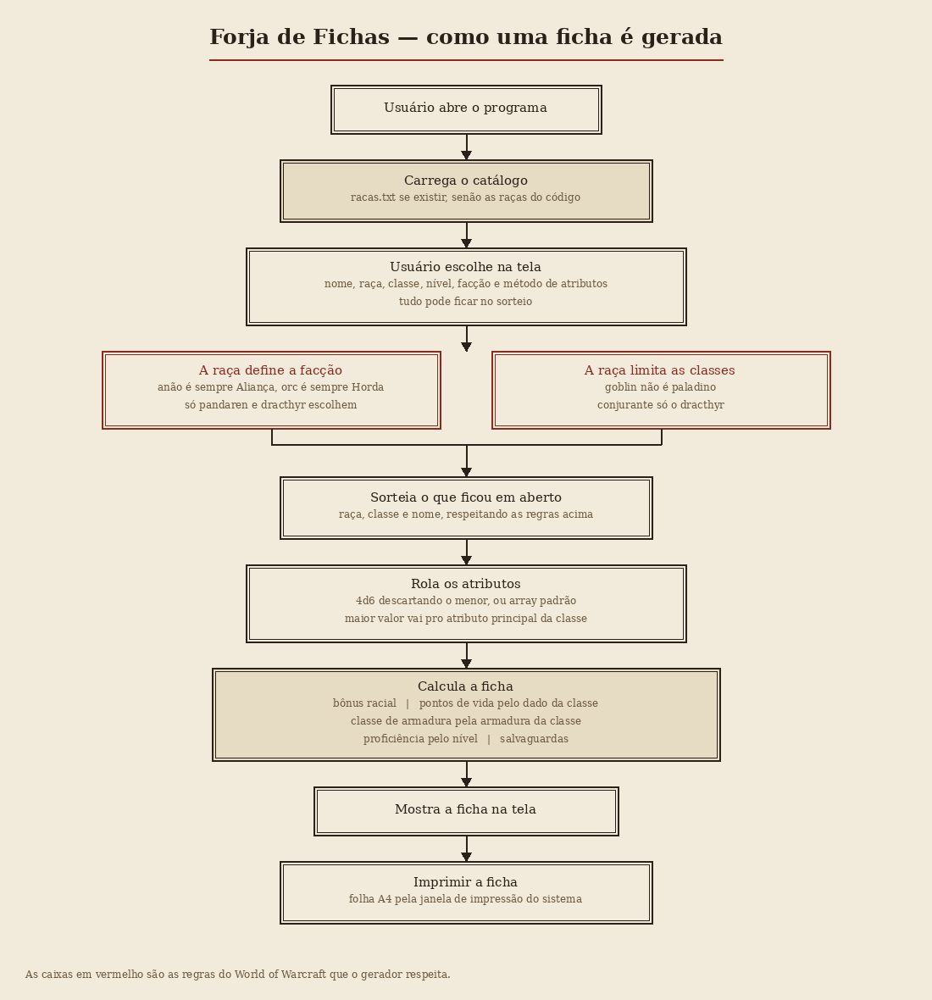

# Forja de Fichas

Gerador de fichas de personagem de World of Warcraft, feito em Java com Swing.
Projeto de extensão.

Você escolhe raça, classe, nível e facção, ou deixa tudo no sorteio, e o
programa monta a ficha inteira: atributos, pontos de vida, classe de armadura,
vantagens raciais e um nome no estilo do povo da personagem. Dá pra imprimir a
ficha ou salvar em PDF pra levar pra mesa.



---

## Como rodar

Precisa de um JDK 17 ou mais novo. No Fedora:

```bash
sudo dnf install java-17-openjdk-devel
cd Gerador_FIcha
./run.sh
```

Ou na mão:

```bash
cd Gerador_FIcha
javac -encoding UTF-8 -d out $(find src -name "*.java")
java -cp out wow.App
```

Pra rodar os testes:

```bash
cd Gerador_FIcha
./testar.sh
```

No IntelliJ ou no VS Code: abre a pasta `Gerador_FIcha`, marca `src` como pasta
de código-fonte e roda `wow.App`.

---

## Como funciona



---

## Estrutura

São 30 arquivos e cerca de 3.500 linhas.

```
Gerador_FIcha/
├── run.sh                 compila e abre o programa
├── testar.sh              compila e roda os testes
├── docs/                  capturas de tela
└── src/wow/
    ├── App.java           onde o programa começa
    ├── model/             só os dados, nenhuma regra de catálogo
    │   ├── Atributo.java  FOR, DES, CON, INT, SAB, CAR e o modificador
    │   ├── Raca.java      bônus, tamanho, vantagens, limitações e facção
    │   ├── Classe.java    dado de vida, atributo principal, salvaguardas, armadura
    │   ├── Armadura.java  tecido, couro, malha e placas
    │   ├── Faccao.java    Aliança, Horda e Neutro
    │   └── Ficha.java     a ficha pronta e as contas dela
    ├── dados/             de onde vêm raças e classes
    │   ├── RepositorioDados.java   a interface
    │   ├── RepositorioLocal.java   as 20 raças e 13 classes escritas no código
    │   ├── RepositorioArquivo.java lê as raças de um arquivo de texto
    │   └── ClassesPorRaca.java     quais classes cada raça pode ser
    ├── service/           o que é sorteado
    │   ├── Dado.java               as rolagens
    │   ├── GeradorAtributos.java   4d6 descartando o menor, ou array padrão
    │   ├── GeradorNomes.java       monta o nome por sílabas
    │   ├── TabelaNomes.java        as sílabas de cada povo
    │   └── GeradorFicha.java       junta tudo e respeita as regras do jogo
    ├── exportacao/
    │   └── FichaImpressa.java      desenha a ficha na folha A4
    ├── testes/
    │   └── Testes.java             43 verificações
    └── ui/                a tela: janela, painel da ficha e os componentes
                           desenhados à mão (pergaminho, capitular, selo de
                           cera, caixas de atributo, botões, ornamentos)
```

---

## O que o cliente pediu, e o que isso mudou

O projeto nasceu como gerador de fichas de D&D 5e e depois virou de World of
Warcraft. As decisões abaixo vieram de pedidos do cliente, não de preferência
técnica.

**"Precisa parecer menos moderno, mais de RPG mesmo."**
A primeira versão da tela era escura, com cantos arredondados e cartões — cara
de aplicativo moderno qualquer. Virou uma mesa de jogo: tampo de couro verde
escuro com folhas de pergaminho apoiadas, tinta ferro-galha no texto e vermelho
de rubrica nos títulos, que é como os manuscritos antigos marcavam o começo de
cada parte. O detalhe principal é a capitular iluminada na inicial do nome, a
letra grande e decorada que abre capítulo em manuscrito medieval. É o único
lugar da tela onde o ouro aparece, de propósito.

Os atributos também mudaram de desenho. Antes eram um selo de d20, bonito mas
que ninguém reconhece. Viraram a caixa clássica da ficha de papel, com o valor
num quadro de régua dupla e o modificador num círculo pendurado na base.

**"Aumenta alguns campos, o nome por exemplo."**
O nome ficou em corpo de título, e todos os campos passaram a ser escritos
sobre uma linha, como num formulário de papel, em vez de dentro de caixas.

**"O cliente gosta de ter coisas físicas na mesa de RPG."**
Daí veio a impressão. A ficha sai em A4, preto sobre branco, com uma pauta no
fim pra anotar dano e iniciativa durante a sessão. O pergaminho fica só na
tela: no papel ele gastaria tinta e atrapalharia a leitura.

**"Vamos mudar o tema do projeto, vai para WoW."**
Raças, classes, nomes, facções e as combinações de raça e classe foram
trocadas. As regras de ficha continuaram sendo as de RPG de mesa, porque o WoW
não tem ficha.

---

## Decisões técnicas e o porquê

### Nenhuma biblioteca externa

O projeto inteiro é só código-fonte. Quem clonar compila com `javac` e roda,
sem Maven, sem Gradle, sem jar pra baixar. Isso valeu pra três coisas:

- **A interface gráfica** é toda desenhada em código. O papel envelhecido, as
  molduras, os florões de canto, o lacre de cera e a capitular são pintados em
  tempo de execução, sem nenhum arquivo de imagem. Assim não existe caminho de
  imagem pra quebrar em outra máquina.
- **As fontes** são as lógicas do Java (`Font.SERIF`), que existem em qualquer
  instalação. No Linux caem em DejaVu Serif, no Windows em Times New Roman.
- **Os testes** não usam JUnit. São um `main` que confere as coisas e conta
  quantas falharam.

### A impressão foi refeita do zero

A primeira versão da exportação eram 617 linhas escrevendo o formato PDF na
mão, com círculo feito de curva de Bézier e tabela xref montada na unha.
Funcionava, mas era o código mais difícil de explicar do projeto.

Foi trocado por `PrinterJob` com `Printable`, que é a impressão padrão do Java:
203 linhas, e desenhando com o mesmo `Graphics2D` que já era usado pra pintar a
tela. O custo é que deixou de ser "salvar PDF" e virou "imprimir" — pra gerar o
PDF a pessoa escolhe "Imprimir em arquivo" no Linux ou "Microsoft Print to PDF"
no Windows.

### O catálogo fica atrás de uma interface

`RepositorioDados` existe pra que a origem dos dados possa mudar sem mexer em
mais nada. Hoje tem duas implementações:

- `RepositorioLocal`, com as 20 raças e as 13 classes escritas no código;
- `RepositorioArquivo`, que lê as raças de um `racas.txt`.

Se existir um `racas.txt` na pasta de onde o programa foi aberto, as raças vêm
dele; senão vêm do código. Se o arquivo estiver quebrado, o programa avisa no
terminal qual linha estragou e segue com as raças do código, em vez de não
abrir. Isso deixa alguém adicionar raça sem recompilar.

As classes continuam sempre vindo do código, porque elas carregam regra
(armadura, dado de vida, salvaguardas) e não só dado solto.

### Portabilidade

O programa é desenvolvido no Linux mas precisa rodar em qualquer lugar:

- compilação sempre com `-encoding UTF-8`, senão o `javac` usa a codificação do
  sistema e quebra em máquina configurada em outra língua;
- nenhum caminho de arquivo escrito no código;
- a janela nasce num tamanho confortável mas nunca maior que o monitor, e o
  formulário rola quando a tela é baixa. Testado em 1366x768;
- o programa confere a versão do Java ao abrir e avisa em português, em vez de
  despejar uma pilha de exceções.

---

## O que veio do jogo e o que foi adaptado

Essa separação é a parte mais importante deste documento.

### Veio do jogo

As **20 raças** e o agrupamento por facção vieram da
[página oficial da Blizzard](https://worldofwarcraft.blizzard.com/pt-br/game/races).
São 8 da Aliança, 10 da Horda e 2 neutras.

As **habilidades raciais** foram conferidas uma a uma no
[wiki oficial do Warcraft](https://warcraft.wiki.gg/wiki/Racial_trait) e em
material sobre o patch atual. Fúria Sanguínea, Robustez, Pisada de Guerra,
Forma de Pedra, Dissimulação, Torrente Arcana, Salto Foguete, Palma Trêmula,
Vontade dos Renegados: todas existem e são dessas raças.

As **13 classes** e os **tipos de armadura** são os do jogo: placas pro
guerreiro, cavaleiro da morte e paladino; malha pro caçador, xamã e conjurante;
couro pro ladino, monge, druida e caçador de demônios; tecido pro mago,
sacerdote e bruxo.

A **facção vem da raça**. Anão é sempre Aliança, orc é sempre Horda. Só
pandaren e dracthyr começam neutros e escolhem o lado.

As **combinações de raça e classe** também são as do jogo. Goblin não é
paladino, tauren não é caçador de demônios, conjurante é só do dracthyr.

### Foi adaptado

O WoW não tem ficha de papel, então três coisas não existem lá e precisaram de
critério:

**Bônus de atributo.** O jogo não dá mais bônus de atributo por raça. Em vez de
chutar, cada bônus aqui sai de uma habilidade racial de verdade: o tauren ganha
Constituição porque tem *Resistência*, que aumenta Vigor no jogo; o draenei
ganha Força, Destreza e Inteligência porque é exatamente o que a *Presença
Heroica* dá; o humano ganha +1 em tudo porque o *Espírito Humano* aumenta todos
os atributos secundários.

**Deslocamento.** No WoW toda raça corre na mesma velocidade, então todas
ficaram com 9 m. Quem corre mais aparece nas vantagens, como o Voo Sombrio do
worgen. Uma versão anterior tinha velocidades diferentes inventadas por mim, e
isso foi corrigido.

**Limitações.** O jogo não tem desvantagem racial. Em vez de inventar defeito
pra cada raça, o campo guarda as limitações reais das próprias habilidades: o
Canibalizar do morto-vivo é cancelado se você se mover, o Regenerano' do troll
zandalari é interrompido por dano, e depois do Salto Foguete o goblin não
consegue frear a queda por 10 segundos. Raça que não tem nenhuma fica sem o
quadro na ficha — e são 14 das 20.

**As regras de ficha** (4d6 descartando o menor, pontos de vida pelo dado da
classe, classe de armadura, bônus de proficiência e salvaguardas) são de RPG de
mesa, não do WoW.

---

## Um erro que vale registrar

A primeira versão das raças foi escrita de memória, sem conferir fonte. Nove
raças ficaram com efeito errado: o Humano tinha *Diplomacia*, que foi removida
do jogo faz anos; o *Abraço Entrópico* do elfo do vazio estava descrito como
recuperação de mana, quando na verdade aumenta dano e cura; o troll zandalari
tinha uma habilidade que nem é da raça dele; vulpera tinha duas inventadas.

Isso só apareceu porque o erro foi procurado de propósito depois. A correção
virou um commit separado, e a partir dela toda informação sobre o jogo passou a
ser conferida em fonte antes de entrar no código. É por isso que a seção acima
existe neste documento: pra deixar claro o que é do jogo e o que é decisão de
projeto.

---

## Testes

`./testar.sh` roda 43 verificações, divididas em sete grupos: catálogo,
combinação de raça e classe, facção, armadura, contas da ficha, nomes e leitura
de raças vindas de arquivo.

Os mais importantes são os que varrem muita combinação de uma vez:

- 3.000 sorteios livres, e nenhum pode dar combinação que o jogo não permite;
- com a raça presa, a classe sorteada tem que servir pra ela, em todas as 20;
- com a classe presa, a raça sorteada tem que poder ser aquilo, em todas as 13;
- forçar a facção contrária em todas as raças, e nenhuma pode ceder;
- 2.000 sorteios de nome de orc têm que dar mais de 500 nomes diferentes.

A suíte devolve código de saída 1 quando alguma verificação falha, então dá pra
usar em integração contínua.

---

## O que dá pra fazer depois

- escudo e equipamento individual, pra classe de armadura ir além do tipo
- salvar e reabrir fichas favoritas
- gerar vários inimigos de uma vez, balanceados pelo nível do grupo
- deixar o `racas.txt` também trazer classes, hoje ele só traz raças
